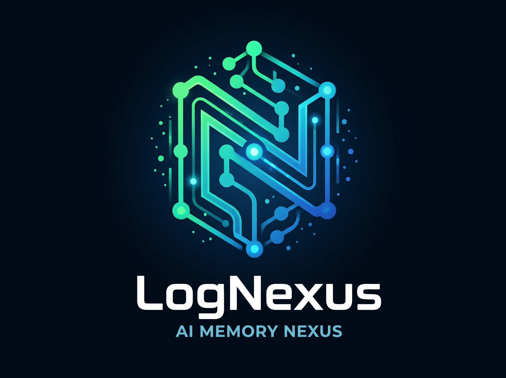
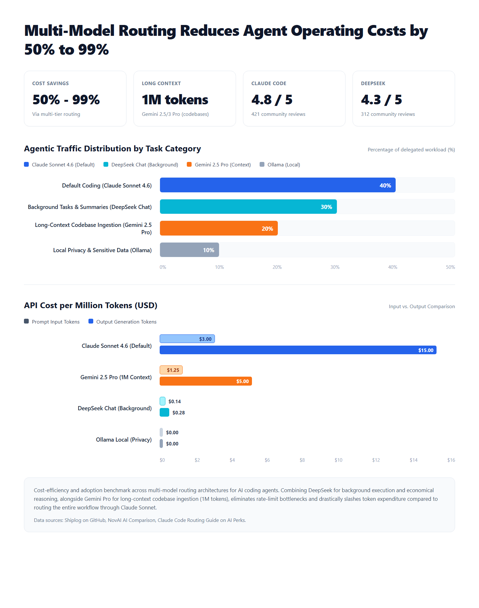

<p align="center">
  
</p>

# LogNexus

<p align="center">
  <strong>The Universal, Git-Powered Context & Rules Framework for Native AI Agents</strong>
</p>

<div align="center">

[](https://github.com/digital-lake-ai/lognexus/actions/workflows/ci.yml)
[](https://www.npmjs.com/package/@digital-lake/lognexus)
[](https://www.npmjs.com/package/@digital-lake/lognexus)
[](https://pypi.org/project/lognexus-mcp/)
[](https://pypi.org/project/lognexus-mcp/)
[](https://glama.ai/mcp/servers/digital-lake-ai/lognexus)
[](https://github.com/digital-lake-ai)
[](https://ko-fi.com/digitallake)

[](https://www.npmjs.com/package/@digital-lake/lognexus)
[](https://socket.dev/npm/package/@digital-lake/lognexus)
[-0d9488)](https://glama.ai/mcp/servers/digital-lake-ai/lognexus)
[](https://github.com/digital-lake-ai/lognexus)
[](https://nodejs.org)
[](#installation--setup)
[](./docs/TELEMETRY_PRIVACY.md)
[](./LICENSE)

</div>

---

## What is LogNexus?

As AI coding agents take on complex engineering tasks across different IDEs, they suffer from a fundamental failure mode: **cognitive amnesia**. Between conversation resets, context compactations, model handoffs, and unexpected bugs, the *why* behind design decisions, discarded alternatives, and technical discoveries vanishes.

**LogNexus transforms Git and GitHub into a persistent, traceable knowledge graph.** It is a **100% generic, model-agnostic and editor-agnostic framework** that operates directly inside your native AI development environments:
- **Clients:** Claude Code, Cursor, Codex, GitHub Copilot, Google Antigravity, Kimi Code, VS Code, Zed.
- **Models:** Anthropic Claude (`Claude Fable 5.2`, `Claude Mythos 5.2`, `Claude Opus / Sonnet / Haiku 5.5`), OpenAI (`GPT-6.2 Astra`, `GPT-6.2 Sol`, `GPT-6 Luna`, `codex-mini`, `o3` / `o4`), Google Gemini (`Gemini 4 Neon`, `Gemini 4 Carbon`, `Gemini 4 Argon`, `Gemini 4 Hydrogen`, `Gemini 3.8 Pro & Flash`), Moonshot AI (`Kimi K3` / Kimi Code), DeepSeek (`R1`, `V3`, `Chat`).
- **Supported Platforms:** **Linux**, **macOS**, and **Windows** (`linux`, `darwin`, `win32` — 100% cross-platform Node.js >= 20 & Git >= 2.28, zero native binary dependencies).

```
Issues (Why & Goals) ──▶ Branches (Task Scopes) ──▶ Commits (Context & Diffs) ──▶ PR (Timeline & Review)
         ▲                                                                                 │
         └─────────────────────── Git-Backed Knowledge Graph ──────────────────────────────┘
```

> **Framework, Not an API Proxy:** LogNexus never intercepts network calls or wraps vendor APIs. Your models remain inside their native IDEs with full access to editor buffers, interactive diff viewers, terminals, MCP servers, and local tools.

---

## Key Features

- **Universal Multi-Model Support:** Native cognitive guidelines and prompt specifications for **Anthropic Claude** (`Claude Fable 5.2`, `Claude Mythos 5.2`, `Claude 5.5`), **OpenAI** (`GPT-6.2 Astra`, `GPT-6.2 Sol`, `GPT-6 Luna`, `codex-mini`, `o3` / `o4`), **Google Gemini** (`Gemini 4 Neon` / `Orchestrator (Neon)`, `Gemini 4 Carbon`, `Gemini 4 Argon`, `Gemini 4 Hydrogen`, `Gemini 3.8 Pro & Flash`), **Moonshot AI** (`Kimi K3` / Kimi Code), and **DeepSeek** (`R1`, `V3`, `Chat`).
- **Universal Client Compatibility:** Drop-in support for **Claude Code**, **Cursor**, **Codex**, **GitHub Copilot** (`.github/copilot-instructions.md`), **Google Antigravity**, and **Kimi Code / VS Code**.
- **Adaptive Ecosystem Routing & Native Swarm Coordination:** Declarative `.lognexus/routing.md` (`orchestration: auto | swarm | subagent | off`, `review_gate: auto | intra-fleet | cross-vendor | advisory | off`, `implementer: auto`, `reviewer: auto`) with Hard Turn-1 Discovery Probes (`> 3` files), immediate Swarm UI handoff, and native Swarm contract flags (`--assignee`, `--isolation swarm`, `--swarm-workers`, `--swarm-posts`).
- **Atomic Commit Engine (`lognexus commit` & MCP `lognexus_commit`):** Validates subtask file contracts, verifies reviewer separation, injects authorship trailers, commits changes, marks subtasks completed, and attaches Git Notes in a single ~0.15s execution.
- **Cross-Model & Intra-Fleet Distinct-Model Review Gates:** Non-negotiable review separation (`Authored-by:` vs `Reviewed-by:`) enforced both at pre-flight note attachment time and during branch audits. Supports cross-vendor review, intra-fleet distinct-model review (`Neon`/`Carbon`/`Argon` reviewing `Hydrogen`/`Flash`; `GPT-6.2 Astra` reviewing `Sol`/`Luna`; `Fable`/`Opus` reviewing `Sonnet`), shared-weights blocking (`Fable <-> Mythos`), and `advisory` / `off` modes for single-session ChatGPT or solo workflows—never forcing cross-vendor review—with strict anti-spoofing and mandatory `--no-ff` merges.
- **Contract-First Subtasks & Alphanumeric Tickets:** Tasks are bounded by strict decision budgets, file allowlists, and stop conditions—supporting both GitHub issues (`feat(#42/T1)`) and Jira/Linear ticket schemes (`feat(SLM-201/T1)`).
- **Persistent State & Session Recovery:** Local session state engine (`.lognexus/state.json`) prevents amnesia across context compactations and conversation resets, retaining completed subtask metadata through the closing commit.
- **Automated Context Handoff (`lognexus handoff`):** Regenerates a complete `.lognexus/handoff.md` from local state — cycle state, active subtask contract, live scope-drift report, completed-subtask table and next required action — so a fresh session (or a different model) resumes without re-deriving context. Auto-refreshed on `state set-task` and on every `--finish-task` commit.
- **Live Scope-Drift & Environment Guard (`lognexus status` / `lognexus doctor`):** Diffs the working tree against the `allowedFiles` of the active contract on every status and diagnostic run, catching out-of-contract writes before they reach a commit. Supports `lognexus doctor --mcp` to validate cross-platform MCP client setups and `.lognexus/policy.json` schemas.
- **Memory Recall & Notes Export (`lognexus note search` / `lognexus note export`):** Queries the LogNexus Git Notes history by file, model, issue or free text, returning the newest matches first, or exports causation-preserving JSONL notes (`note export`) for offline auditing and session handoffs.
- **Startup Update & Legal Terms Gate:** A non-interactive gate surfaces update and legal-terms requirements at CLI startup, consulting the npm registry through `execFileSync` with `shell: false` and a 2500 ms timeout. The MCP transport is exempt.
- **Git Notes Engine (Quiet Mode / `git-ai` v3):** Attaches structured session payloads and contracts to commits under `refs/notes/lognexus` without changing commit SHAs.
- **Native MCP Stdio Server (`lognexus mcp`):** Zero-dependency JSON-RPC 2.0 stdio server exposing LogNexus tools, live state resources, and prompts to Claude Desktop, Cursor, and any MCP client.
- **Journey Timeline & Review Gate Audit:** Reconstructs the complete branch journey into structured PR descriptions (`lognexus timeline --pr-body`) and programmatically audits review gate separation (`lognexus audit`) under `.lognexus/policy.json` profiles (`default`, `incremental`, `strict`) with a hardcoded review-gate error floor.
- **Hidden Metadata Envelopes:** HTML comments preserve machine-parseable state (`<!-- lognexus: kind: state ... -->`) without cluttering human-readable markdown.
- **Scaffolding & Health CLI (`@digital-lake/lognexus`):** Lightweight CLI for repository scaffolding (`init`), health diagnostics (`doctor`), and real-time status inspection (`status`).
- **Optional Multi-Model Token Shield (`init --protect-tokens`):** Opt-in, zero-runtime-overhead workspace hygiene flag that scaffolds official context-exclusion and read-deny rules (`.geminiignore`, `.aiexclude`, `.cursorignore`, `.claude/settings.json` covering `node_modules/**`, lockfiles, `dist/**`, `dist-pypi/**`, `.next/**`, `.venv/**`, `__pycache__/**`, `.rooignore`, `.codeiumignore`, `.aiderignore`) tailored to the agent ecosystems detected in your repository—preventing accidental token leakage on lockfiles and build artifacts, translating directly into lower context costs without touching the MCP server.

---

## Model-Tier Routing Matrix

LogNexus organizes development phases into three cognitive tiers. You can assign any model or native client to any tier according to your team's workflow and cost preferences:

<p align="center">
  
</p>

### Operational Tiers

| Tier | Cognitive Role | Anthropic Claude | OpenAI | Google Gemini | DeepSeek | Primary Activities |
|---|---|---|---|---|---|---|
| **tier-1 (Reasoning)** | Deep synthesis, architectural design, narrative review | Claude Fable 5.2 / Mythos 5.2 / Opus 5.5 | GPT-6.2 Astra, o3, o4, GPT-5 | Gemini 4 Neon / Carbon / Argon, 3.8 Pro | DeepSeek R1 | Brainstorming-to-issue planning, PR journey timeline synthesis, cross-model & intra-fleet review sign-offs. |
| **tier-2 (Context & Triage)** | Long context ingestion, discovery triage, structured mapping | Claude Sonnet 5.5 | GPT-6.2 Sol, Codex, gpt-oss, GPT-4o | Gemini 4 Hydrogen, Gemini 3.8 Flash High / Pro (1M) | DeepSeek V3 | Large codebase exploration, discovery classification, scoped implementation, knowledge retrieval. |
| **tier-3 (Execution)** | Surgical implementation, template filling, fast execution | Claude Haiku 5.5 | GPT-6 Luna, codex-mini, o4-mini, GPT-4o-mini | Gemini 3.8 Flash, `gemini-flash-worker-agy` | DeepSeek Chat (V3) | Subtask commits (`feat(#N/Tk)`), atomic code changes under closed contracts, timeline logging. |

### Adaptive Routing & Deployment Setups

LogNexus adapts automatically to single-provider and multi-vendor toolstacks. Configure `.lognexus/routing.md` with linear `O(n)` directives:

```markdown
routing: confirm
orchestration: auto
review_gate: auto
implementer: auto
reviewer: auto
```

- `orchestration`: `auto | swarm | subagent | off` (`auto` activates native `swarm` under Antigravity `Orchestrator` after plan confirmation).
- `review_gate`: `auto | cross-vendor | intra-fleet | advisory | off` (`auto` resolves to `intra-fleet` distinct-model verification when running in a single-provider fleet; ChatGPT / OpenAI Codex workflows never force cross-vendor review, and single-session solo workflows may use `advisory` or `off`).

```
┌──────────────────────────────────────────────────────────────────────────────────────────┐
│                                 POPULAR DEPLOYMENT SETUPS                                │
├──────────────────────────────────────────────────────────────────────────────────────────┤
│ Setup A (Claude Code):       Claude Fable 5.2 / Opus 5.5 (t1) + Sonnet (t2) + Haiku (t3) │
│ Setup B (Antigravity Fleet): Gemini 4 Neon/Carbon/Argon (t1) + Hydrogen/Flash (t2/t3)    │
│ Setup C (ChatGPT / Codex):   GPT-6.2 Astra (t1) + GPT-6.2 Sol (t2) + GPT-6 Luna (t3)     │
│ Setup D (Cross-Vendor):      Claude Fable 5.2 / Opus (t1) + GPT-6 Luna / DeepSeek (t3)   │
└──────────────────────────────────────────────────────────────────────────────────────────┘
```

---

## Quickstart & Golden Path

LogNexus coordinates the full issue-to-merge lifecycle through intuitive slash commands:

### 1. Capture the Plan
```bash
/lognexus plan
```
Transforms an exploratory brainstorm into a structured GitHub Issue with discrete subtasks (`T1..Tn`), verification criteria, and tier tags.

### 2. Start Work on a Clean Branch
```bash
/lognexus start <issue-number>
```
Creates an ID-prefixed branch (`issue/<id>-<slug>`) from the default branch tip and logs a signed `[lognexus/session-start]` note.

### 3. Commit with Traceability
```bash
/lognexus commit
```
Stages changes and generates structured, task-scoped commits (`feat(#42/T1): ...`) paired with an issue progress update.

### 4. Synthesize the Pull Request
```bash
/lognexus pr
```
Compiles all commits, discoveries, discarded alternatives, and verification steps into a comprehensive Journey Timeline inside the PR description.

### 5. Cross-Model Review & Gate Verification
```bash
/lognexus review
```
An independent model inspects the PR diff, verifies task contracts, and signs off (`Reviewed-by: <model>`) before merge.

---

## Installation & Setup

### 1. Scaffold Rules & Manage State with the CLI

Initialize `.lognexus/` rules, templates, and routing configuration:
```bash
npx @digital-lake/lognexus init

# Optional: scaffold official multi-model context-exclusion rules (zero runtime overhead)
# to prevent agents from burning tokens on lockfiles or build directories:
npx @digital-lake/lognexus init --protect-tokens

# Optional: pre-seal local telemetry consent in an interactive human terminal
npx @digital-lake/lognexus init --enable-telemetry
npx @digital-lake/lognexus init --no-telemetry
```

Verify your environment anytime (including multi-manifest SemVer drift checks and MCP client configuration health):
```bash
npx @digital-lake/lognexus doctor
npx @digital-lake/lognexus doctor --mcp
```

Inspect active branch, ecosystem profile, review gate mode, and tier advisory:
```bash
npx @digital-lake/lognexus status
```

Manage persistent agent state (`.lognexus/state.json`), native swarm contracts, and session recovery:
```bash
npx @digital-lake/lognexus state sync
npx @digital-lake/lognexus state show
npx @digital-lake/lognexus state set-task T1 "Add user schema" \
  --assignee "google/gemini-4-hydrogen-high (antigravity)" \
  --isolation swarm --swarm-workers 2 --swarm-posts 4 \
  --allowed "src/schema.ts,tests/schema.test.ts" \
  --verify "npm test"
npx @digital-lake/lognexus state finish-task T1
```

Execute an **Atomic Commit** (validates subtask contract, enforces review-gate separation, injects trailers, commits, marks subtask completed, and attaches Git Note in a single ~0.15s call):
```bash
npx @digital-lake/lognexus commit -m "feat(#42/T1): add user schema" \
  --author "google/gemini-4-hydrogen-high (antigravity)" \
  --stage-allowed \
  --swarm-workers 2 --swarm-posts 4 \
  --finish-task

# Or read message from file (cross-platform on Linux, macOS, and Windows shells):
npx @digital-lake/lognexus commit -F commit-msg.txt --stage-allowed --finish-task
```

Quiet Mode with Git Notes (`refs/notes/lognexus`, standard `git-ai` v3):
```bash
npx @digital-lake/lognexus note attach HEAD --swarm-workers 2 --swarm-posts 4
npx @digital-lake/lognexus note show HEAD
npx @digital-lake/lognexus note push origin
npx @digital-lake/lognexus note export --since main -o notes.jsonl
```

Journey Timeline reconstruction and Review Gate audit (configured via `.lognexus/policy.json` with `default`, `incremental`, `strict` profiles and a non-overridable review-gate error floor):
```bash
npx @digital-lake/lognexus timeline main
npx @digital-lake/lognexus timeline main --pr-body
npx @digital-lake/lognexus audit main
```

Session continuity, scope-drift and memory recall:
```bash
# Regenerate .lognexus/handoff.md from live state (--json or --prompt for compact agent dispatch)
npx @digital-lake/lognexus handoff
npx @digital-lake/lognexus handoff --prompt
npx @digital-lake/lognexus handoff --json

# Inspect the working tree against the active subtask contract and validate MCP client health
npx @digital-lake/lognexus status
npx @digital-lake/lognexus doctor
npx @digital-lake/lognexus doctor --mcp

# Recall past reasoning from Git Notes or export topological JSONL
npx @digital-lake/lognexus note search "scope drift"
npx @digital-lake/lognexus note search --file src/cli.ts
npx @digital-lake/lognexus note search --issue 30 --limit 5
npx @digital-lake/lognexus note search --author "deepseek" --json
npx @digital-lake/lognexus note export --issue 30 -o notes.jsonl
```

Opt-in Telemetry 2.0, LOC-Weighted ROI & Cohort Benchmarks (100% local, zero network calls):
```bash
# Check telemetry status (disabled by default, 0% overhead; interactive [y/N] Policy v2.0.0 gate on human TTY)
npx @digital-lake/lognexus telemetry status

# Enable or disable local telemetry (stores metrics only in .lognexus/telemetry.json, schemaVersion 2.0.0)
npx @digital-lake/lognexus telemetry enable
npx @digital-lake/lognexus telemetry disable

# Generate .lognexus/telemetry.md report with LOC-weighted ROI (optionally scoped in-memory)
npx @digital-lake/lognexus telemetry report
npx @digital-lake/lognexus telemetry report --issue 42 --since 2026-11-01T00:00:00Z --branch main

# Inspect the exact Zero-PII payload structure (optionally scoped in-memory)
npx @digital-lake/lognexus telemetry inspect --issue 42

# Export an offline Zero-PII snapshot and aggregate multi-repo cohort benchmarks locally
npx @digital-lake/lognexus telemetry snapshot -o .lognexus/snapshot-v2.json --issue 42
npx @digital-lake/lognexus telemetry benchmark ./snapshots -o .lognexus/cohort.md --json
```
Telemetry 2.0 is **strictly local-only**: zero network egress, zero PII, and `O(1)` fail-silent passive hooks (100% silent in automated agent sessions). Sealed GDPR consent (`Policy v2.0.0`) pauses automatically on material policy bumps until a human re-confirms in an interactive terminal. The retired `--share --accept-terms` flags fail with an explicit error, and pre-2.0.0 stores migrate to `local` / `schemaVersion: "2.0.0"` on save.

*Read our strict Zero-PII, zero-network policy in [`docs/TELEMETRY_PRIVACY.md`](docs/TELEMETRY_PRIVACY.md).*

### 2. Connect via Model Context Protocol (MCP)

LogNexus includes a native, lightweight JSON-RPC 2.0 stdio server (`lognexus mcp`) with zero external SDK dependencies. Connect it to Claude Desktop, Cursor, Google Antigravity, or any MCP-compliant client:

**`claude_desktop_config.json` or Cursor MCP settings** — config file locations per operating system:
- **macOS:** `~/Library/Application Support/Claude/claude_desktop_config.json`
- **Linux:** `~/.config/Claude/claude_desktop_config.json`
- **Windows:** `%APPDATA%\Claude\claude_desktop_config.json`
- **Cursor / VS Code:** `.cursor/mcp.json` or `.vscode/mcp.json`

```json
{
  "mcpServers": {
    "lognexus": {
      "command": "npx",
      "args": ["-y", "@digital-lake/lognexus", "mcp"]
    }
  }
}
```

**Or install automatically via Smithery:**
```bash
npx -y @smithery/cli install @digital-lake/lognexus --client claude
```

**Or run via Python (`uvx` / `pip` from PyPI):**
```bash
# Zero-install MCP stdio launch via uvx:
uvx lognexus-mcp

# Or install globally via pip / pipx:
pip install lognexus-mcp
```

**Exposed Capabilities:**
- **Tools:** `lognexus_status`, `lognexus_state_get`, `lognexus_state_sync`, `lognexus_state_set_task`, `lognexus_state_finish_task`, `lognexus_state_clear`, `lognexus_commit`, `lognexus_note_show`, `lognexus_note_attach`, `lognexus_timeline`, `lognexus_audit`, `lognexus_telemetry`
- **Resources:** `lognexus://state`, `lognexus://routing`, `lognexus://handoff`
- **Prompts:** `lognexus-plan`, `lognexus-review`

### 3. Install Rules in Your Agent Environment

- **Claude Code:**
  ```bash
  claude plugin add digital-lake-ai/lognexus
  ```
- **Cursor / Codex / Agent Skills:**
  ```bash
  npx skills add digital-lake-ai/lognexus
  ```
- **Google Antigravity:** Active automatically via `skills/lognexus/SKILL.md` or workspace skills.
- **GitHub Copilot / VS Code / Kimi Code:** Active via `.github/copilot-instructions.md` and `.lognexus/` workspace instructions and prompts.

---

## ⚡ Production Telemetry & Field Benchmark

<div align="center">


-238636?style=for-the-badge&labelColor=0d1117)

-238636?style=for-the-badge&labelColor=0d1117)

</div>

LogNexus was battle-tested in a high-intensity production deployment governing the end-to-end engineering of an enterprise static analysis CLI and AI migration skill (**Anonymous Project ID:** `prj-7a4e91c2`) operating over **250,000+ lines of legacy code** with 22 AST/CFG rules (`SPH-001`..`SPH-022`).

```
╔══════════════════════════════════════════════════════════════════════════════════════════════╗
║  LOGNEXUS TELEMETRY HUD // PRODUCTION SWARM BENCHMARK (PROJECT ID: PRJ-7A4E91C2)             ║
╠═════════════════════════════════════════════╦════════════════════════════════════════════════╣
║  ▸ GOVERNED FEATURES     12 Issues (#1-#12) ║  ▸ ORPHAN / UNTRACKED COMMITS   0 (0.0%)       ║
║  ▸ VERIFIED COMMITS      38 / 38 Signed     ║  ▸ SELF-APPROVAL VIOLATIONS     0 Blocked      ║
║  ▸ GIT NOTES ATTACHED    100% (git-ai v3)   ║  ▸ SCOPE CREEP INCIDENTS        0 (Allowlist)  ║
║  ▸ TEST SUITE INTEGRITY  536 Passed (100%)  ║  ▸ ATOMIC COMMIT LATENCY        ~0.15s / op    ║
╚═════════════════════════════════════════════╩════════════════════════════════════════════════╝
```

### Multi-Model Swarm Performance Matrix

By enforcing **Closed Delegation Contracts** (`allowedFiles`, `forbiddenFiles`, `decisionBudget: "none"`) and **Cross-Model Review Gates**, LogNexus coordinated three distinct AI model families in production without a single context leak or rogue commit:

| Model Family | Assigned Tier | Production Strengths Observed | Optimal Contract Fit |
| :--- | :---: | :--- | :--- |
| **Google Antigravity / Gemini Pro** | `tier-1` & `tier-2`<br>*(Architect & Orchestrator)* | • Zero-drift multi-branch coordination<br>• Strict review-gate enforcement (`lognexus audit`)<br>• Rapid root-cause regression triage | Architecture synthesis, closed contract authoring, cross-model code review, release governance. |
| **DeepSeek V3 (Chat)** | `tier-3`<br>*(Scoped Implementer)* | • Ultra-low latency & token cost<br>• Exceptional at mathematical AST parsing, pushdown automata & CFG tokenization<br>• Strict adherence to stop conditions when hitting out-of-scope test assertions | Algorithmic engines, deterministic parsers, isolated single-file modules (`<500` LOC). |
| **Kimi K2.7 Code** | `tier-2` & `tier-3`<br>*(High-Context Implementer)* | • Massive context retention with zero file truncation on large modules (`>500` LOC)<br>• Flawless single-shot multi-file generation (rule catalogs + visitors + test suites) | Large-context refactorings, multi-file rule catalogs, CI/CD matrices & standalone packaging. |

> **Key Takeaway:** Contract-driven development paired with `refs/notes/lognexus` completely eliminated scope creep by Tier-3 implementers while keeping the public Git commit graph 100% clean and human-readable.

---

## Disambiguation

**LogNexus** by Digital Lake is an open-source development framework and Git memory system for AI agents. It is not affiliated with academic research papers on industrial log compression (e.g. ISSTA 2026).

---

## 🛡️ Verified Quality & Supply-Chain Security

<div align="center">

[](https://glama.ai/mcp/servers/digital-lake-ai/lognexus)

</div>

Every published release is continuously measured against independent third-party evaluators. The table below summarises the current external audit snapshot:

| Auditor | Scope | Result |
|---|---|---|
| **Glama MCP Directory** | Server quality & maintenance score (TDQS) | **Triple A** grading · **TDQS 4.3 / 5.0** (`Grade A`) |
| **Socket Security** | Vulnerability audit | **100 / 100** — `0 CVEs` |
| **Socket Security** | Quality & License compliance | **100 / 100** |
| **Socket Security** | Maintenance health | **96 / 100** |
| **SLSA Provenance** | Build supply chain | **Verified** (`SLSA Provenance`, OIDC-signed npm publish) |
| **License & Contribution model** | Open governance | **MIT** — Open Source, Core-Maintained (**Closed to Unsolicited External PRs**) |
| **Awesome MCP Servers** | Community MCP directory ([`punkpeye/awesome-mcp-servers`](https://github.com/punkpeye/awesome-mcp-servers) / [`HorchataHTML/awesome-mcp-servers`](https://github.com/HorchataHTML/awesome-mcp-servers)) | Listed under *Version Control* (`📇 🏠 🍎 🪟 🐧` — TypeScript, Local, **macOS**, **Windows**, **Linux**) |
| **Smithery & Claude Plugin** | Native MCP & Plugin registries (`smithery.yaml`, `.claude-plugin/plugin.json`, `skills/lognexus/SKILL.md`) | Verified Cross-Platform (`Linux`, `macOS`, `Windows`) |
| **MCP Registry & PyPI** | Official `server.json` & Python launcher (`lognexus-mcp`) | Verified (`io.github.digital-lake-ai/lognexus` · `npx` & `uvx` across **Linux**, **macOS**, **Windows**) |

> **Local-first by construction:** LogNexus ships `0` runtime network calls, `0` PII, and `0` telemetry endpoints. See [`docs/TELEMETRY_PRIVACY.md`](docs/TELEMETRY_PRIVACY.md) and [`SECURITY.md`](SECURITY.md).

### Provenance & Identities

Every commit carries signed provenance trailers (`Planned-by:` / `Authored-by:` / `Reviewed-by:`). Identities are declared with their canonical spellings:

| Role | Canonical identity |
|---|---|
| Master Architecture & Security Orchestrators | `Gemini 4 Neon` (`Orchestrator (Neon)`) · `Gemini 4 Carbon` · `Gemini 4 Argon` |
| Implementation (Antigravity / VS Code clients) | `google/gemini-4-hydrogen-high (antigravity)` · `google/gemini-3.8-flash-high (antigravity)` · `deepseek/VS Code (kimi-code)` |
| Independent review (Cross-Vendor & Intra-Fleet) | `Claude Fable 5.2` · `Claude Opus 5.5` · `OpenAI GPT-6.2 Astra` · `Gemini 4 Neon` · `Gemini 4 Carbon` · `Gemini 4 Argon` |

The `Planned-by:` trailer documents where an externally authored plan came from. It grants no review authority and no merge rights; an author model never writes its own `Reviewed-by:` trailer.

---

## Provenance & Acknowledgments

**LogNexus** is engineered and maintained by **[HorchataHTML](https://github.com/HorchataHTML)** and **[Digital Lake](https://github.com/digital-lake-ai)**, encompassing:
- The full TypeScript runtime, repository scaffolding & diagnostic CLI, Persistent Agent State Engine, Atomic Commit Engine, Git Notes memory layer (`refs/notes/lognexus`), local-first FinOps telemetry, Multi-Model Token Shield, and native JSON-RPC 2.0 stdio MCP server (`@digital-lake/lognexus` / `lognexus-mcp`).
- First-class multi-model tier routing and closed delegation contracts across **Anthropic Claude** (`Fable 5.2`, `Mythos 5.2`, `Opus / Sonnet / Haiku 5.5`), **OpenAI** (`GPT-6.2 Astra`, `GPT-6.2 Sol`, `GPT-6 Luna`, `codex-mini`, `o3` / `o4`), **Google Gemini** (`Gemini 4 Neon`, `Gemini 4 Carbon`, `Gemini 4 Argon`, `Gemini 4 Hydrogen`, `Gemini 3.8 Pro & Flash`), **Moonshot AI** (`Kimi K3` / Kimi Code), and **DeepSeek** (`R1`, `V3`, `Chat`).
- The cross-reference CI validation workflow (`.github/workflows/cross-ref-check.yml`), single-source-of-truth review/signing block architecture, and sub-skill anchor normalization authored by **HorchataHTML** (`2026-08-04`, commit `cd0582c1`).

The **Master Architecture & Security Plan** governing frontier-model support, supply-chain hardening, and cross-model review governance is authored and signed by **`Gemini 4 Neon`**, **`Gemini 4 Carbon`**, and **`Gemini 4 Argon`** (*Master Architecture & Security Orchestrators*).

Additional workflow inspirations and patterns are derived from [OrchestKit](https://github.com/yonatangross/orchestkit) and [Superpowers](https://github.com/obra/superpowers). Detailed license texts and notices are preserved in the [`LICENSES/`](LICENSES/) directory and in [`NOTICE.md`](NOTICE.md).

LogNexus is an independent continuation and full-stack TypeScript, CLI, and native MCP evolution of shiplog.

---

<div align="center">

### Did you find this project useful? 🤖⚡

Maintaining and evolving open-source agentic infrastructure takes time, dedication, and... quite a few **AI tokens** to power multi-model benchmarking, automated testing, and continuous architecture updates.

If **LogNexus** saved you time, prevented context amnesia in your workflows, and you'd like to help cover the API and compute costs to keep it evolving, consider fueling the AI with a token:

[](https://ko-fi.com/digitallake)

*Every contribution goes straight into compute power, multi-model benchmarks, new MCP capabilities, and continuous improvements!*

</div>

---

## License

LogNexus is released under the [MIT License](LICENSE).  
Copyright (c) 2026 HorchataHTML (https://github.com/HorchataHTML)  
Copyright (c) 2026 Digital Lake (https://github.com/digital-lake-ai) and LogNexus contributors.  
Copyright (c) 2026 devallibus
