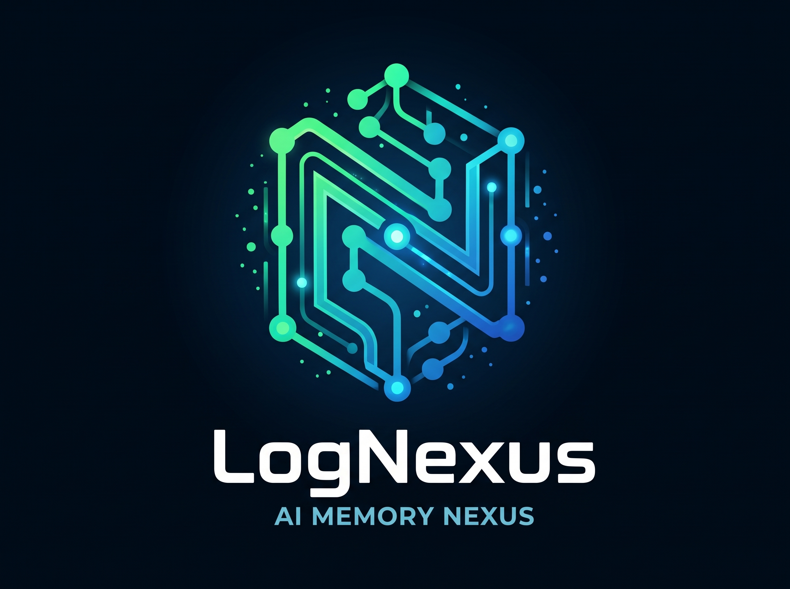
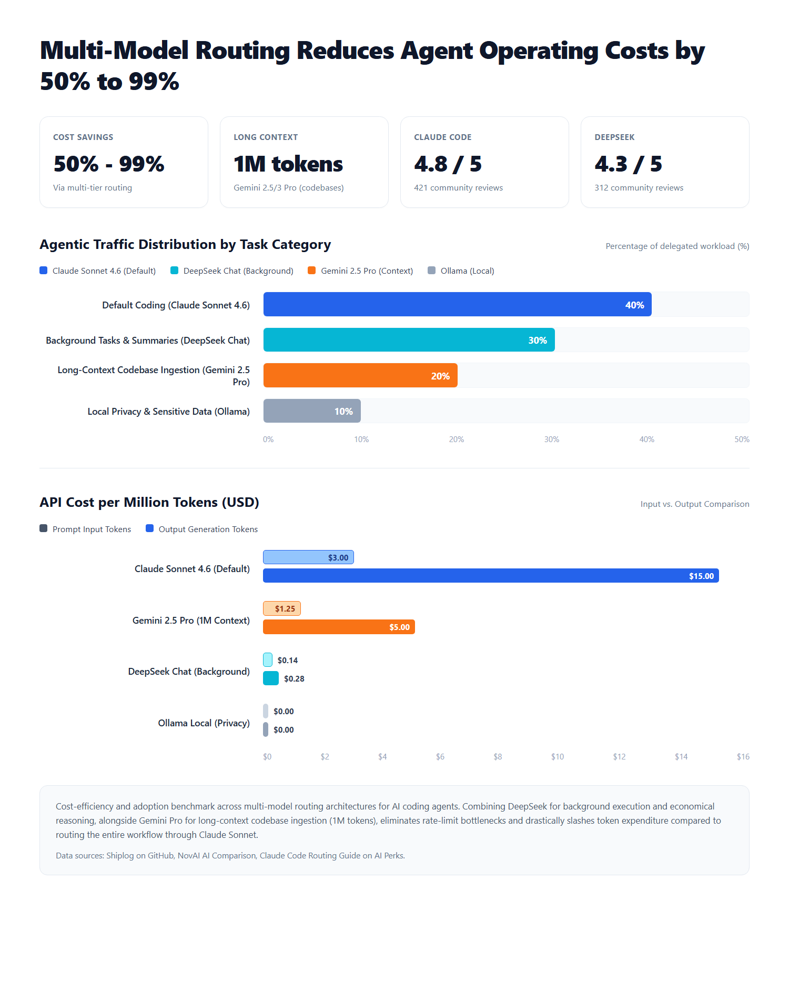
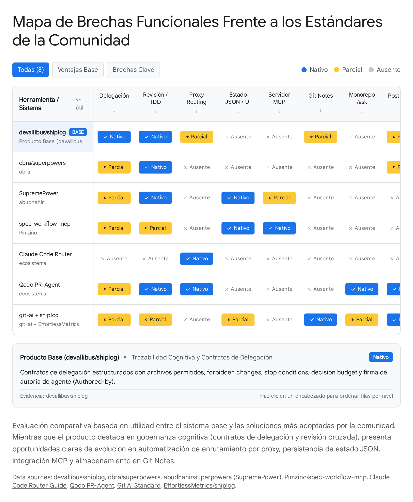

<p align="center">
  
</p>

# LogNexus

<p align="center">
  <strong>The Git-Powered Context & Rules Framework for Native AI Agents</strong>
</p>

<p align="center">
  <a href="https://github.com/digital-lake-ai/lognexus/actions"></a>
  <a href="https://www.npmjs.com/package/@digital-lake/lognexus"></a>
  <a href="LICENSE"></a>
  <a href="https://github.com/digital-lake-ai/lognexus"></a>
</p>

---

## What is LogNexus?

As AI coding agents take on complex engineering tasks across different IDEs, they suffer from a fundamental failure mode: **cognitive amnesia**. Between conversation resets, context compactations, model handoffs, and unexpected bugs, the *why* behind design decisions, discarded alternatives, and technical discoveries vanishes.

**LogNexus transforms Git and GitHub into a persistent, traceable knowledge graph.** It operates directly inside your native AI development environments (**Google Antigravity**, **Kimi Code**, **Cursor**, **Claude Code**), governing human-agent and multi-agent workflows through structured rules, delegation contracts, and Git-backed audit trails.

```
Issues (Why & Goals) ──▶ Branches (Task Scopes) ──▶ Commits (Context & Diffs) ──▶ PR (Timeline & Review)
         ▲                                                                                 │
         └─────────────────────── Git-Backed Knowledge Graph ──────────────────────────────┘
```

> **Framework, Not an API Proxy:** LogNexus does not intercept API calls or pull models out of their native environments. Your models remain inside their native IDEs with full access to editor buffers, diff viewers, terminals, MCP servers, and browser tools.

---

## Key Features

- **Native IDE Client Integration:** Runs directly as an Agent Skill in **Google Antigravity**, **Kimi Code**, **Cursor**, and **Claude Code**.
- **Model Specialization (Prompt & Contract Engineering):**
  - **Google Gemini (in Antigravity):** High-reasoning orchestrator (`tier-1` & `tier-2`). Leverages 1M+ context tokens and Antigravity tooling to structure brainstorms into issues, write closed delegation contracts, and synthesize PR journey timelines.
  - **DeepSeek (in Kimi Code / Cursor):** High-speed surgical implementer (`tier-3`). Executes bounded delegation contracts with strict allowlists (`feat(#N/Tk)`), zero decision budget, and native editor context.
- **Cross-Model Review Gates:** Non-negotiable review separation (`Authored-by:` vs `Reviewed-by:`). No model merges its own code without independent verification from another model.
- **Contract-First Subtasks:** Tasks are bounded by strict decision budgets, file allowlists, and stop conditions.
- **Hidden Metadata Envelopes:** HTML comments preserve machine-parseable state (`<!-- lognexus: kind: state ... -->`) without cluttering human-readable markdown.
- **Repository Scaffolding CLI (`@digital-lake/lognexus`):** One-command setup (`npx @digital-lake/lognexus init`) and environment health checking (`doctor`).

---

## Cognitive Specialization & Model Tiers

Rather than executing external API calls, LogNexus provides specialized prompting and rule templates optimized for how each model reasons within its native client:

<p align="center">
  
</p>

### Operational Tiers

| Tier | Native IDE / Model | Primary Role |
|---|---|---|
| **tier-1 (Reasoning)** | **Gemini in Google Antigravity** · Claude Opus · DeepSeek Reasoner | Architectural design, brainstorm-to-issue structuring, PR journey timeline synthesis, and cross-model review gates. |
| **tier-2 (Context)** | **Gemini (1M Context) in Antigravity** | Comprehensive codebase exploration, discovery triage, and repository documentation. |
| **tier-3 (Execution)** | **DeepSeek in Kimi Code / Cursor** | Fast, surgical implementation under closed contracts (`Decision budget: none`), atomic task commits, and timeline updates. |

---

## Architecture & Competitive Positioning

LogNexus advances agentic development workflows beyond passive markdown instructions into an active, verifiable development platform.

<p align="center">
  
</p>

---

## Quickstart & Golden Path

LogNexus coordinates the full issue-to-merge lifecycle through intuitive slash commands:

### 1. Capture the Plan (Antigravity / Gemini)
```bash
/lognexus plan
```
Transforms an exploratory brainstorm into a structured GitHub Issue with discrete subtasks (`T1..Tn`), verification criteria, and tier tags.

### 2. Start Work on a Clean Branch
```bash
/lognexus start <issue-number>
```
Creates an ID-prefixed branch (`issue/<id>-<slug>`) from the default branch tip and logs a signed `[lognexus/session-start]` note.

### 3. Commit with Traceability (Kimi Code / DeepSeek)
```bash
/lognexus commit
```
Stages changes and generates structured, task-scoped commits (`feat(#42/T1): ...`) paired with an issue progress update.

### 4. Synthesize the Pull Request (Antigravity / Gemini)
```bash
/lognexus pr
```
Compiles all commits, discoveries, discarded alternatives, and verification steps into a comprehensive Journey Timeline inside the PR description.

### 5. Cross-Model Review & Gate Verification
```bash
/lognexus review
```
An independent model inspects the PR diff, verifies task contracts, and signs off (`Reviewed-by: <model>`) before merge.

---

## Installation & Setup

### 1. Scaffold Rules in Your Repository
Initialize `.lognexus/` rules, templates, and routing configuration with the CLI:

```bash
npx @digital-lake/lognexus init
```

Verify your environment anytime:
```bash
npx @digital-lake/lognexus doctor
```

Inspect active branch and agent advisory:
```bash
npx @digital-lake/lognexus status
```

### 2. Install Rules in Your Agent Environment

- **Google Antigravity:** The skill is active automatically when present in `skills/lognexus/` or can be loaded via workspace skills.
- **Claude Code:**
  ```bash
  claude plugin add digital-lake-ai/lognexus
  ```
- **Cursor / Codex / Agent Skills:**
  ```bash
  npx skills add digital-lake-ai/lognexus
  ```

---

## Disambiguation

**LogNexus** by Digital Lake is an open-source development framework and Git memory system for AI agents. It is not affiliated with academic research papers on industrial log compression (e.g. ISSTA 2026).

---

## Based on & Acknowledgments

LogNexus is an independent hard fork and continuation of [`shiplog`](https://github.com/devallibus/shiplog), originally created by **devallibus** under the MIT License.

We extend our deep gratitude to **devallibus** for pioneering the concept of Git-as-knowledge-graph for AI development. LogNexus builds upon that foundation by introducing:
- Native IDE specialization for **Google Gemini** (Antigravity) and **DeepSeek** (Kimi Code).
- Closed delegation contract protocols and advisory tier transitions.
- Standalone repository scaffolding CLI (`@digital-lake/lognexus`).
- Resilient backwards-compatibility for existing `.shiplog` envelopes and workflows.

Additional inspirations and patterns are derived from [OrchestKit](https://github.com/yonatangross/orchestkit) and [Superpowers](https://github.com/obra/superpowers). Detailed license texts are preserved in the [`LICENSES/`](LICENSES/) directory and in [`NOTICE.md`](NOTICE.md).

---

## License

LogNexus is released under the [MIT License](LICENSE).  
Copyright (c) 2026 devallibus  
Copyright (c) 2026 Digital Lake and LogNexus contributors.
