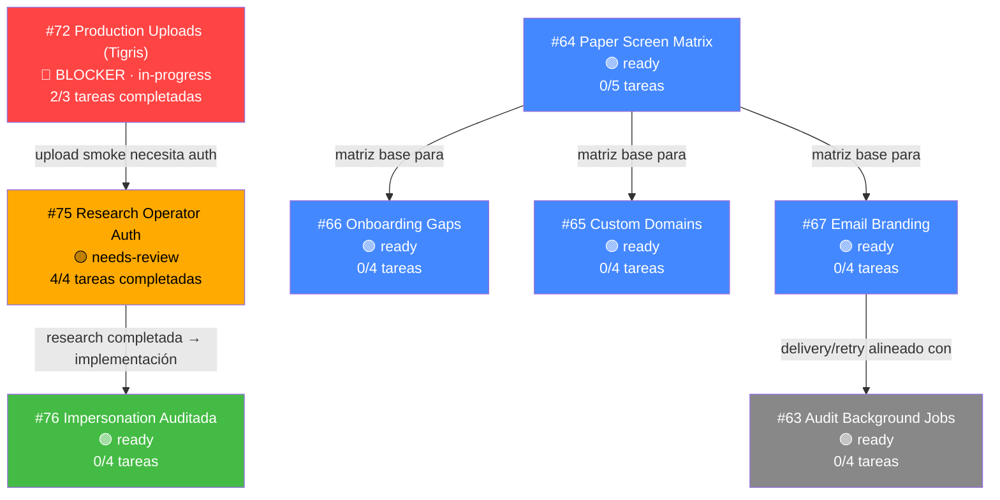

# 🚢 Shiplog Hunt — Análisis de Prioridades

> Fecha: 15 Jul 2026 · Repositorio: [GustoDigital/gd-dashboard](https://github.com/GustoDigital/gd-dashboard)

---

## Estado Actual del Tablero

| Issues abiertos | PRs abiertos | PRs mergeados (desde 19 Jun) |
|:-:|:-:|:-:|
| **8** | **2** | **3** |

---

## Grafo de Dependencias

---

## Tier 1 — Desbloquear ahora 🔴

### [#72](https://github.com/GustoDigital/gd-dashboard/issues/72) — Production Uploads on Fly Tigris

| Campo | Valor |
|-------|-------|
| Estado | `in-progress` + `blocker` |
| Progreso | **2/3 tareas** completadas (T1 ✅, T2 ✅) |
| Pendiente | **T3**: Smoke test de uploads en producción después del cutover a master |
| PRs | [#73](https://github.com/GustoDigital/gd-dashboard/pull/73) mergeado, [#74](https://github.com/GustoDigital/gd-dashboard/pull/74) abierto (custom domains wire) |
| Bloqueo | El smoke de uploads necesita una sesión autenticada en producción → depende de #75/#77 |

> [!WARNING]
> Este issue está marcado como **blocker** y le falta solo 1 tarea. Sin embargo, esa tarea (smoke test autenticado en producción) depende de que el PR #77 (operator auth) se mergee primero. Es el cuello de botella principal.

### [#75](https://github.com/GustoDigital/gd-dashboard/issues/75) — Research Operator Auth

| Campo | Valor |
|-------|-------|
| Estado | `needs-review` |
| Progreso | **4/4 tareas** completadas |
| PR | [#77](https://github.com/GustoDigital/gd-dashboard/pull/77) abierto (+2504 líneas, -16) — **awaiting review** |
| Resultado | Diseño completo: local/staging email-password para agentes, producción sigue Google OAuth only |

> [!IMPORTANT]
> La investigación está terminada y el PR #77 está listo para review. **Mergear este PR desbloquea**: el smoke test de #72/T3 y la base del Admin plugin que necesita #76.

---

## Tier 2 — Siguiente sprint 🟡

### [#76](https://github.com/GustoDigital/gd-dashboard/issues/76) — Impersonation Auditada para Soporte

| Campo | Valor |
|-------|-------|
| Estado | `ready` |
| Tareas | 0/4 · **max_tier: tier-1** (seguridad) |
| Dependencia | Necesita que #75/#77 se mergeen primero |
| Valor | Crítico para operaciones de soporte gestionado — sin esto, el equipo no puede ayudar a clientes de forma segura y auditable |

### [#64](https://github.com/GustoDigital/gd-dashboard/issues/64) — Paper Screen Matrix

| Campo | Valor |
|-------|-------|
| Estado | `ready` |
| Tareas | 0/5 · max_tier: tier-3 |
| Dependencia | Ninguna — es prerequisito de #65, #66 y #67 |
| Valor | Auditoría fundamental que define qué superficies del producto están implementadas, parciales o faltantes |

---

## Tier 3 — Backlog priorizado 🟢

Estos issues están listos pero dependen de que #64 (la matriz) se complete primero:

| Issue | Descripción | Tareas | Depende de |
|-------|------------|--------|------------|
| [#66](https://github.com/GustoDigital/gd-dashboard/issues/66) | Onboarding y setup gaps | 0/4 | #64 |
| [#65](https://github.com/GustoDigital/gd-dashboard/issues/65) | Custom domain operations | 0/4 | #64 |
| [#67](https://github.com/GustoDigital/gd-dashboard/issues/67) | Email branding y templates | 0/4 | #64, #63 |
| [#63](https://github.com/GustoDigital/gd-dashboard/issues/63) | Audit background jobs/cron | 0/4 | Ninguna |

---

## Recomendación de Acción

> [!TIP]
> ### Orden propuesto:
>
> **1️⃣ Reviewear y mergear PR #77** (operator auth) → Desbloquea #72 y #76
>
> **2️⃣ Completar #72/T3** (production upload smoke) → Cierra el blocker
>
> **3️⃣ Arrancar #76** (impersonation auditada) ó **#64** (Paper matrix) en paralelo
>
> La elección entre #76 y #64 depende de tu prioridad inmediata:
> - **#76 primero** si necesitas que el equipo de soporte pueda operar cuentas de clientes ya
> - **#64 primero** si prefieres mapear el producto completo antes de implementar más superficies

### ¿Qué podemos hacer ahora mismo?

El paso más inmediato y productivo es **revisar el PR #77** para desbloquearlo todo. ¿Quieres que empiece por ahí?
